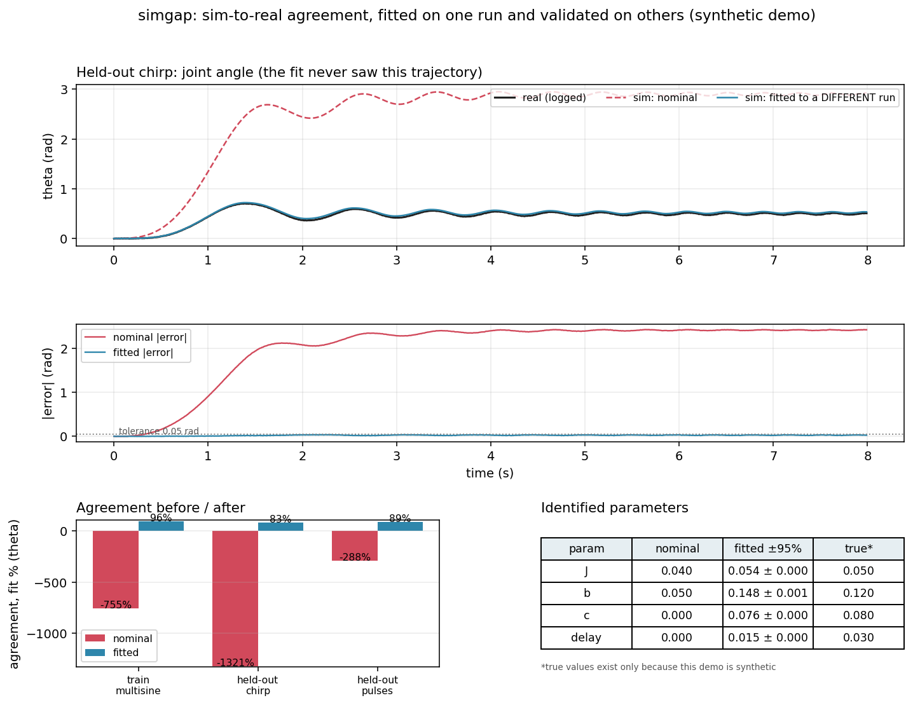

# simgap

Measure how closely a simulator agrees with logged robot data, fit the
simulator to one logged run, and report the agreement on runs the fit
never saw.

Built around one rotary robot joint, because that is the smallest system
the whole loop (measure, fit, validate) runs end to end on honestly.



## Run the demo

```
pip install numpy scipy matplotlib
python demo.py
```

One command produces, in `out/`:

- `agreement_report.png`: held-out trajectory overlay, error over time
  against a 0.05 rad tolerance, agreement before/after fitting for all
  runs, and the identified parameter table.
- `report.json`: every number in the figure.
- `*_real.csv`: the logged runs (t, theta, omega, u).

## What it does

`simgap.py` is the library:

- `simulate(params, u, t)`: the joint model
  `J * omega' = u(t - delay) - b * omega - c * tanh(omega / eps) - quad * omega * |omega|`,
  RK4 integration, actuator latency by interpolation.
- `agreement(traj, params)` and `agreement_table(runs, params)`: per
  channel RMSE, max abs error, agreement "fit %" (normalised fit:
  100% perfect, 0% as good as guessing the log's mean, negative is
  worse), and the first time the error crosses a tolerance (0.05 rad
  on theta, 0.5 rad/s on omega), or "never".
- `fit(runs, p0)`: fits J, b, c, delay to logged runs by minimising
  free-run simulation error (scipy least_squares), and reports 95%
  intervals from the Jacobian at the solution.
- `Trajectory`: one run (t, theta, omega, u), with CSV export.

## The finding the demo is built around

Agreement is not the same as correct physics. The stand-in "real"
robot in demo.py has quadratic drag. The fitted model has no drag
term, so the fit hides the drag inside the viscous damping parameter:
the fitted damping lands well away from the true value while held-out
agreement still scores high. Both numbers are reported, side by side,
because quoting only the agreement score would be misleading. On real
hardware you do not know the true values, which is exactly why the
parameter table and the held-out agreement have to be read together.

## What this does NOT show

- The demo data is **synthetic**. The "real" trajectories are generated
  by a ground-truth model with known parameters plus sensor noise,
  because there is no robot here. True values are printed only because
  synthetic data has them.
- It is **one joint** and one model structure, chosen by the author.
  Nothing here shows it scales to multi-joint arms, contact, or
  flexible dynamics.
- The fit is **free-run** (open-loop over the whole trajectory).
  That is well behaved on this damped joint over 8 seconds, and known
  to be fragile on long or unstable trajectories; fitting on short
  windows is the standard fix and is future work, not a feature here.
- The 95% intervals are fit precision under linearised, Gaussian
  assumptions. Unmodelled effects bias the parameters, as the damping
  value shows, and the intervals do not capture that bias.
- Nothing here has touched real robot logs yet. The API takes any
  logged run in CSV form (t, theta, omega, u), which is the point at
  which it would stop being a demo.
